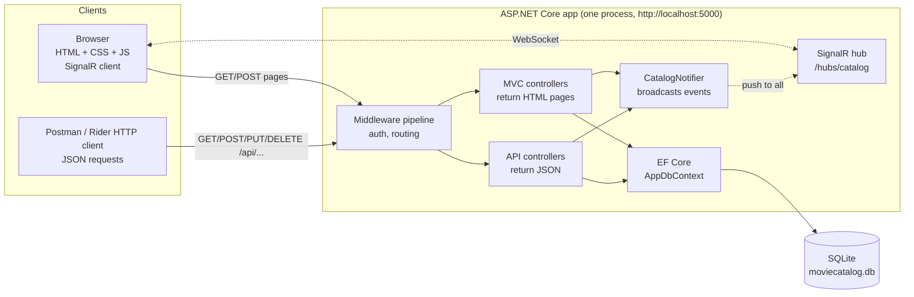
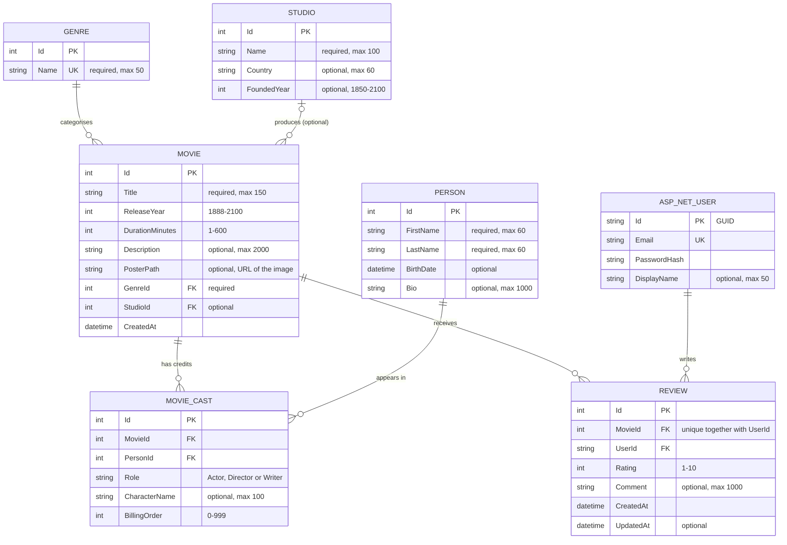
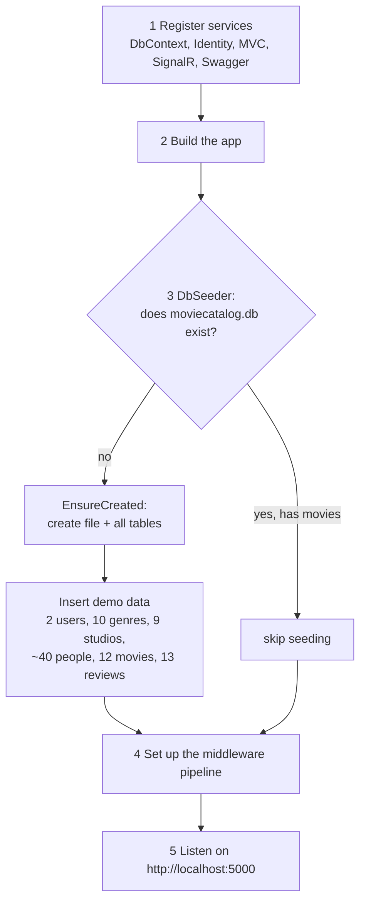
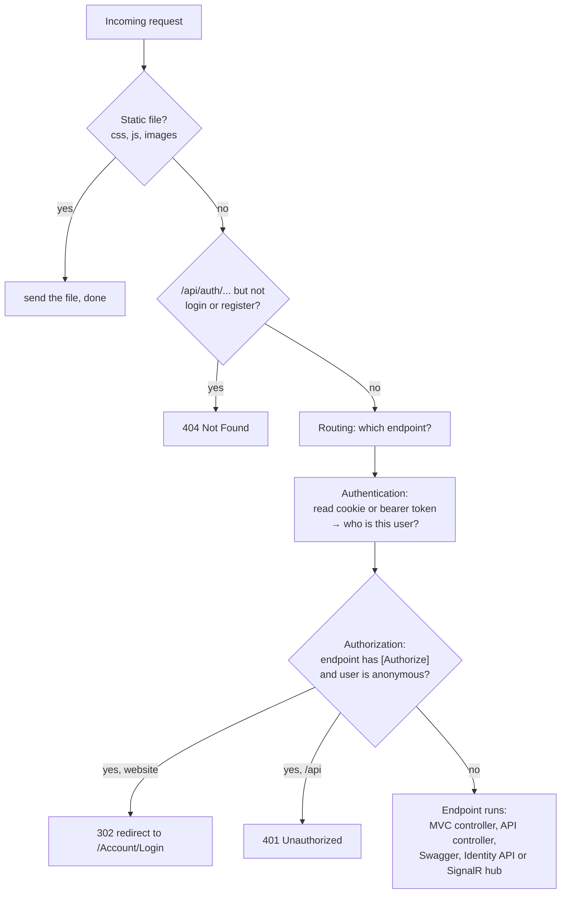
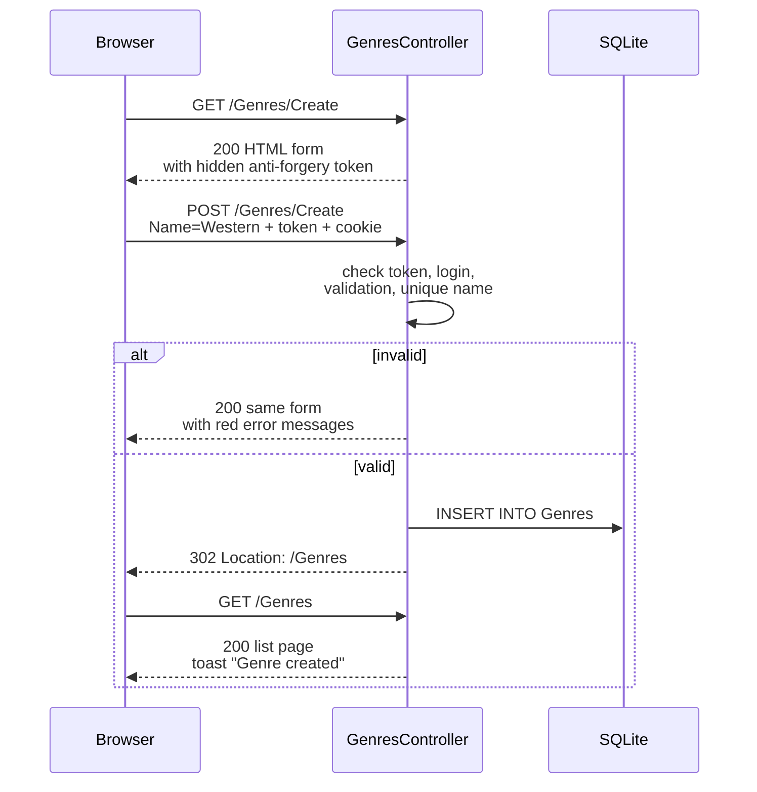
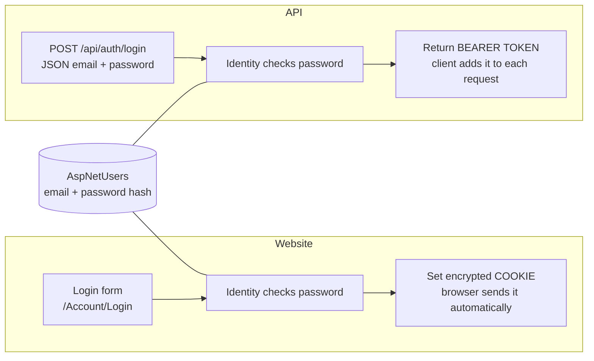
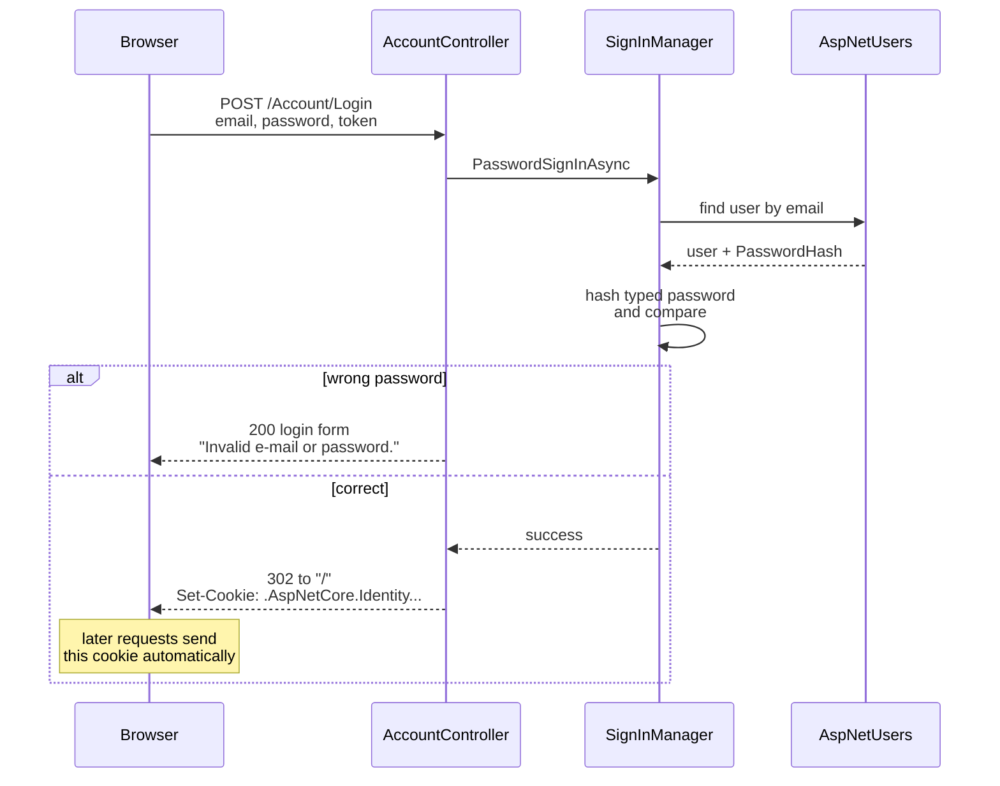
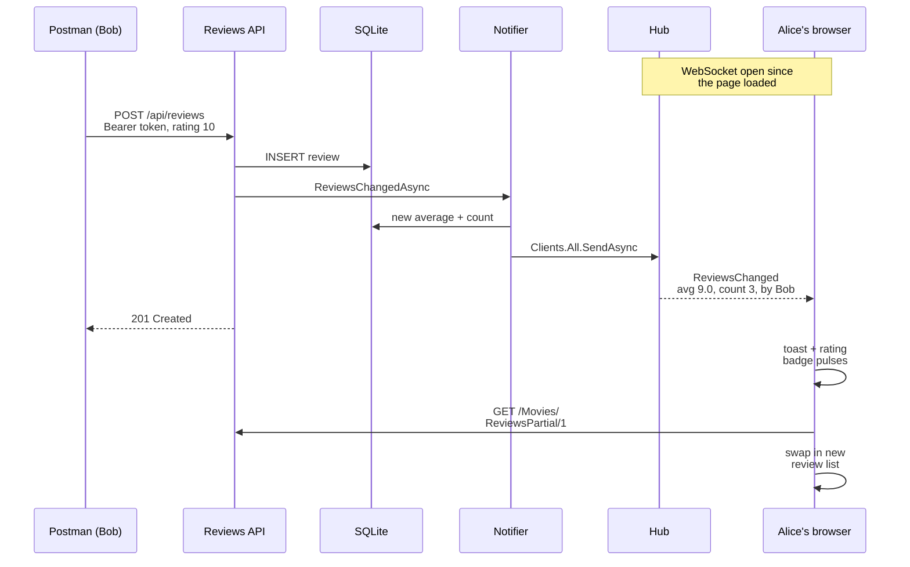
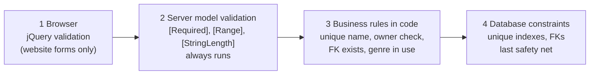

# Movies – how it all works

A complete walkthrough of the project: technologies, structure, database, HTTP requests, authentication and the real-time (SignalR) part. Diagrams are written in **Mermaid** and render as pictures in Rider's Markdown preview and on GitHub.

**Contents**

1. [What the app is](#1-what-the-app-is)
2. [Technologies](#2-technologies)
3. [Big picture: front end vs back end](#3-big-picture-front-end-vs-back-end)
4. [Project structure](#4-project-structure)
5. [The database](#5-the-database)
6. [What happens when the app starts](#6-what-happens-when-the-app-starts)
7. [The life of an HTTP request](#7-the-life-of-an-http-request)
8. [Controllers: website and API](#8-controllers-website-and-api)
9. [Authentication and authorization](#9-authentication-and-authorization)
10. [Real time with SignalR](#10-real-time-with-signalr)
11. [Validation and HTTP status codes](#11-validation-and-http-status-codes)
12. [The front end](#12-the-front-end)
13. [Tools for the demo](#13-tools-for-the-demo)
14. [Design decisions and limitations](#14-design-decisions-and-limitations)
15. [Likely questions and short answers](#15-likely-questions-and-short-answers)

---

## 1. What the app is

An IMDb-style movie catalogue. Anyone can browse movies, people, cast, genres, studios and reviews. Logged-in users can create, edit and delete records and write reviews. Reviews and new movies show up **live** in every open browser, with no refresh.

The same data is reachable in two ways:

- the **website** (HTML pages, for people), and
- a **REST API** (JSON, for programs such as Postman).

Both run inside one ASP.NET Core application and share the same database, rules and users.

---

## 2. Technologies

| Layer | Technology | What it does here |
|---|---|---|
| Runtime / framework | **.NET 8** (runs on 8, 9 or 10 via `RollForward=Major`) | The platform everything runs on |
| Web framework | **ASP.NET Core 8 MVC** | Web server, routing, controllers, Razor views |
| Data access | **Entity Framework Core 8** (ORM) | Maps C# classes ⇄ database tables, writes the SQL |
| Database | **SQLite** | A single file, `moviecatalog.db`, needs no server installed |
| Users and login | **ASP.NET Core Identity** | User table, password hashing, cookie login, bearer tokens |
| Real time | **SignalR** | Pushes events from the server to browsers (WebSockets) |
| API docs | **Swagger / OpenAPI** (Swashbuckle) | Interactive API page at `/swagger` |
| Page templates | **Razor** (`.cshtml`) | HTML with C# mixed in, rendered on the server |
| Styling | **Bootstrap 5** + own `site.css` | Layout grid, components, dark theme |
| Browser scripts | Plain JavaScript + SignalR JS client | Toasts, delete confirmations, live updates |
| Language | **C# 12** | All back-end code |

The NuGet packages in `MovieCatalog.csproj` are `Microsoft.AspNetCore.Identity.EntityFrameworkCore`, `Microsoft.EntityFrameworkCore.Sqlite` and `Swashbuckle.AspNetCore`. Everything else ships with ASP.NET Core.

---

## 3. Big picture: front end vs back end

This is a **server-rendered** app. There is no separate front-end project such as React. The C# back end builds finished HTML pages and sends them to the browser, so the "front end" is the HTML, CSS and JavaScript that the browser ends up running.



| Back end (runs on the server, C#) | Front end (runs in the browser) |
|---|---|
| `Controllers/`, `Controllers/Api/` | The HTML generated from `Views/` |
| `Models/`, `Data/`, `Dtos/`, `ViewModels/` | `wwwroot/css/site.css` |
| `Hubs/`, `Services/`, `Program.cs` | `wwwroot/js/site.js` and small scripts inside some views |
| `Views/*.cshtml` are *written* here and *rendered* on the server | `wwwroot/lib/` (Bootstrap, jQuery validation, SignalR client) |

---

## 4. Project structure

```
movie/
├─ MovieCatalog.sln                  ← open this in Rider / Visual Studio
├─ README.md                         ← how to run + demo script
├─ DOCUMENTATION.md                  ← this file
├─ publish-portable.ps1              ← builds a stand-alone .exe (backup plan)
├─ postman/Movies.postman_collection.json
└─ MovieCatalog/                     ← the web project
   ├─ Program.cs                     [back]  startup: services + middleware pipeline
   ├─ MovieCatalog.csproj            [back]  target framework + NuGet packages
   ├─ MovieCatalog.http              [tool]  Rider HTTP client requests
   ├─ Properties/launchSettings.json [tool]  port 5000, opens the browser
   ├─ Models/Entities.cs             [back]  the 6 entity classes + AppUser
   ├─ Data/AppDbContext.cs           [back]  EF Core: tables, relations, delete rules
   ├─ Data/DbSeeder.cs               [back]  creates the DB + demo data on first run
   ├─ Controllers/                   [back]  8 MVC controllers → HTML pages
   │  └─ Api/                        [back]  6 API controllers → JSON
   ├─ Dtos/ApiDtos.cs                [back]  API request/response shapes
   ├─ ViewModels/ViewModels.cs       [back]  data passed to the views
   ├─ Hubs/CatalogHub.cs             [back]  SignalR hub (presence counter)
   ├─ Services/CatalogNotifier.cs    [back]  sends live events to all browsers
   ├─ Services/PosterStorage.cs      [back]  saves uploaded poster images
   ├─ Views/                         [front] Razor pages, one folder per controller
   │  └─ Shared/_Layout.cshtml       [front] navbar + page frame used by every page
   └─ wwwroot/                       [front] static files served as-is
      ├─ css/site.css                        dark theme
      ├─ js/site.js                          toasts, confirm dialog, SignalR
      ├─ images/posters/                     12 poster images
      └─ lib/                                Bootstrap, jQuery, SignalR client
```

**Pattern: MVC (Model–View–Controller).**

- The **Model** is the data (`Models/`).
- The **View** is the HTML template (`Views/`).
- The **Controller** receives the request, talks to the database and picks a view (`Controllers/`).

---

## 5. The database

### 5.1 Entity–relationship diagram



How to read the lines: `||` means exactly one, `|o` means zero or one, and `o{` means zero or many.

### 5.2 The relationships in words

| Relationship | Type | Foreign key | When the "one" side is deleted |
|---|---|---|---|
| Genre → Movies | **1 : n** | `Movie.GenreId` (required) | **Restrict**: blocked while the genre still has movies |
| Studio → Movies | **0..1 : n** | `Movie.StudioId` (nullable) | **Set null**: the movies stay, their studio becomes empty |
| Movie → MovieCast | **1 : n** | `MovieCast.MovieId` | **Cascade**: its credits are deleted too |
| Person → MovieCast | **1 : n** | `MovieCast.PersonId` | **Cascade**: their credits are deleted too |
| Movie ↔ Person | **n : m** | through `MovieCast` | (the join table carries extra data: role, character, order) |
| Movie → Reviews | **1 : n** | `Review.MovieId` | **Cascade** |
| User → Reviews | **1 : n** | `Review.UserId` | **Cascade** |

**Extra restrictions**

- **Unique index on `Genre.Name`:** two genres can't have the same name.
- **Unique index on `(Review.MovieId, Review.UserId)`:** one review per user per movie.
- **`MovieCast.Role` is stored as text** (`"Director"`) instead of a number, so the table is readable in the DB viewer.
- **Validation attributes** (`[Required]`, `[StringLength]`, `[Range]`) are checked by ASP.NET before anything reaches the database (see §11).

These rules are written in C# in `AppDbContext.OnModelCreating`. EF Core turns them into real SQL constraints. For example:

```csharp
b.Entity<Movie>()
    .HasOne(m => m.Genre).WithMany(g => g.Movies)
    .HasForeignKey(m => m.GenreId)
    .OnDelete(DeleteBehavior.Restrict);      // can't delete a genre that still has movies

// one review per user per movie
b.Entity<Review>().HasIndex(r => new { r.MovieId, r.UserId }).IsUnique();
```

### 5.3 All tables in the file

- **The 6 app tables:**
  - `Movies`, `Genres`, `Studios`, `People` hold the main data.
  - `MovieCast` is the join table between movies and people.
  - `Reviews` connects to users.
- **7 Identity tables**, created automatically by ASP.NET Core Identity:
  - `AspNetUsers` holds the users and their password hashes.
  - `AspNetRoles`, `AspNetUserRoles`, `AspNetUserClaims`, `AspNetUserLogins`, `AspNetUserTokens` and `AspNetRoleClaims` exist but are empty, because the app uses no roles or external logins.

### 5.4 How code talks to the database (EF Core)

You never write SQL by hand. You write LINQ in C#, and EF Core translates it:

```csharp
// C#
db.Reviews.Where(r => r.MovieId == 1).OrderByDescending(r => r.CreatedAt).ToListAsync();
```
```sql
-- what EF Core sends to SQLite (simplified)
SELECT * FROM Reviews WHERE MovieId = 1 ORDER BY CreatedAt DESC;
```

Saving works the same way: change C# objects, then call `db.SaveChangesAsync()`. EF Core works out the `INSERT`, `UPDATE` and `DELETE` statements.

---

## 6. What happens when the app starts

`Program.cs` runs once, top to bottom:



To start again with fresh data, stop the app and delete `MovieCatalog/moviecatalog.db`.

---

## 7. The life of an HTTP request

Every request, whether from the browser or Postman, passes through the **middleware pipeline** in this order:



### 7.1 Example: a website page (GET)

```
GET /Movies/Details/1 HTTP/1.1
Host: localhost:5000
Cookie: .AspNetCore.Identity.Application=CfDJ8...   ← only if logged in
```
```
HTTP/1.1 200 OK
Content-Type: text/html; charset=utf-8

<!DOCTYPE html><html> … Inception … </html>
```

The URL maps to a controller and action through the default route `{controller}/{action}/{id}`. In this example that's `MoviesController.Details(1)`.

### 7.2 Example: a website form (POST → redirect → GET)

Forms use the **Post/Redirect/Get** pattern. After a successful save the server redirects, so pressing F5 can't submit the form twice.



### 7.3 Example: an API call (JSON)

```
POST /api/reviews HTTP/1.1
Host: localhost:5000
Authorization: Bearer CfDJ8KxV...
Content-Type: application/json

{ "movieId": 1, "rating": 9, "comment": "Posted from Postman" }
```
```
HTTP/1.1 201 Created
Location: http://localhost:5000/api/reviews/14
Content-Type: application/json

{ "id": 14, "movieId": 1, "movieTitle": "Inception", "userId": "fc8f1760-…", "author": "Alice",
  "rating": 9, "comment": "Posted from Postman", "createdAt": "…", "updatedAt": null }
```

---

## 8. Controllers: website and API

There are **6 tables**, and each one has **two controllers**: one for the website and one for the API. They all follow the same pattern, so only one example of each kind is shown in full below.

| Table | Website controller (HTML) | Pages | API controller (JSON) | API URL |
|---|---|---|---|---|
| Movies | `MoviesController` | list, details, create/edit form | `MoviesApiController` | `/api/movies` |
| Genres | `GenresController` | tiles, form | `GenresApiController` | `/api/genres` |
| Studios | `StudiosController` | table, form | `StudiosApiController` | `/api/studios` |
| People | `PeopleController` | list, details, form | `PeopleApiController` | `/api/people` |
| MovieCast | `CastController` | list, form | `CastApiController` | `/api/cast` |
| Reviews | `ReviewsController` | list, edit | `ReviewsApiController` | `/api/reviews` |
| – | `HomeController` | home, search | – | – |
| Users | `AccountController` | login, register, logout | Identity API | `/api/auth/login`, `/api/auth/register` |

**The CRUD pattern, the same for every table:**

| Operation | Website (MVC) | API (REST) |
|---|---|---|
| **R**ead list | `GET /Genres` → HTML | `GET /api/genres` → JSON array |
| **R**ead one | `GET /People/Details/5` | `GET /api/genres/5` → JSON or 404 |
| **C**reate | `GET /Genres/Create` (form) + `POST /Genres/Create` | `POST /api/genres` → 201 |
| **U**pdate | `GET /Genres/Edit/5` (form) + `POST /Genres/Edit/5` | `PUT /api/genres/5` → 204 |
| **D**elete | `POST /Genres/Delete/5` (after the confirm dialog) | `DELETE /api/genres/5` → 204 |

Reads are public. Create, update and delete need a logged-in user (`[Authorize]`).

### 8.1 Example website controller: Genres

```csharp
[HttpPost, Authorize, ValidateAntiForgeryToken]
public async Task<IActionResult> Create([Bind("Name")] Genre genre)
{
    await ValidateUnique(genre);                          // extra rule: name must be unique
    if (!ModelState.IsValid) return View("Form", genre);  // show the form again with errors
    db.Genres.Add(genre);
    await db.SaveChangesAsync();                          // INSERT
    TempData["Toast"] = $"Genre \"{genre.Name}\" created.";
    return RedirectToAction(nameof(Index));               // 302 → GET /Genres
}
```

- `[Authorize]`: only logged-in users can run this action.
- `[ValidateAntiForgeryToken]`: protects against CSRF (another site submitting the form in your name).
- `[Bind("Name")]`: only the `Name` field is accepted from the form, which protects against over-posting.
- `db`: the `AppDbContext`, handed to the controller by **dependency injection** through the constructor.

### 8.2 Example API controller: Reviews (the most complete one)

```csharp
[ApiController, Route("api/reviews")]
public class ReviewsApiController(AppDbContext db, UserManager<AppUser> users, CatalogNotifier notifier) : ControllerBase
{
    [HttpPut("{id:int}"), Authorize]
    public async Task<IActionResult> Update(int id, ReviewUpdateInput input)
    {
        var review = await db.Reviews.FindAsync(id);
        if (review is null) return NotFound();                                    // 404
        var user = (await users.GetUserAsync(User))!;
        if (review.UserId != user.Id)
            return StatusCode(403, new { error = "You can only edit your own reviews." }); // 403

        review.Rating = input.Rating;
        review.Comment = input.Comment;
        review.UpdatedAt = DateTime.UtcNow;
        await db.SaveChangesAsync();                                              // UPDATE
        await notifier.ReviewsChangedAsync(review.MovieId, "updated", review.Rating, user); // live push
        return NoContent();                                                       // 204
    }
}
```

- `[ApiController]`: invalid JSON input is rejected with **400** automatically, before the method runs.
- The input type is a **DTO** (`ReviewUpdateInput`), not the database entity. The client can only send the fields the API allows.
- The responses follow REST conventions: `201 Created` with a `Location` header for a new item, `204 No Content` after an update or delete, and `404`, `403` and `409` for problems.

### 8.3 Special rules beyond the basic CRUD

| Where | Rule |
|---|---|
| Genres | Can't be deleted while movies use them. Website shows an error toast, API returns **409**. |
| Reviews | Only the author can edit or delete (**403**). One review per movie (**409**). |
| Movies | Poster upload (jpg/png/webp/gif, max 5 MB) is saved to `wwwroot/uploads/` by `PosterStorage`. |
| Movies, Reviews | After saving, `CatalogNotifier` pushes a live event (see §10). |
| Foreign keys | The API checks that the referenced genre, studio, movie or person exists, and returns **400** if not. |

---

## 9. Authentication and authorization

- **Authentication** answers *who are you?* (logging in).
- **Authorization** answers *what may you do?* (permissions).

### 9.1 One user table, two ways to prove who you are



| | Website | API (Postman) |
|---|---|---|
| Proof of login | Cookie `.AspNetCore.Identity.Application` | Header `Authorization: Bearer <token>` |
| Who sends it | The browser, automatically | The client, explicitly (Postman does it with `{{token}}`) |
| Lifetime | 7 days ("Remember me") | 1 hour, then log in again |
| Not logged in | 302 redirect to the login page | 401 Unauthorized |

Both the cookie and the token are **encrypted and signed** by ASP.NET Core Data Protection, so a client can't read or forge them. The token is not a JWT; it's ASP.NET Identity's own token format. The app accepts either proof on any endpoint.

**Passwords** are never stored. Identity stores a salted **hash** (PBKDF2). At login, the typed password is hashed again and the two hashes are compared.

### 9.2 Website login, step by step



### 9.3 API login, step by step

```
POST /api/auth/login HTTP/1.1
Content-Type: application/json

{ "email": "alice@demo.com", "password": "Demo123!" }
```
```
HTTP/1.1 200 OK
Content-Type: application/json

{
  "tokenType": "Bearer",
  "accessToken": "CfDJ8KxV…(long string)…",
  "expiresIn": 3600,
  "refreshToken": "CfDJ8Lr2…"
}
```

The Postman collection and the Rider `.http` file save `accessToken` automatically. Every later request then carries:

```
Authorization: Bearer CfDJ8KxV…
```

Of the endpoints ASP.NET Identity offers, only **login** and **register** are enabled. Refresh, forgot password, email confirmation and 2FA return **404**, because the app doesn't use them and has no email service.

### 9.4 Who may do what (authorization)

| Action | Anonymous visitor | Logged-in user |
|---|---|---|
| Browse and search everything, read reviews | ✅ | ✅ |
| Create, edit and delete movies, genres, studios, people, cast | ❌ (login / 401) | ✅ |
| Write a review | ❌ | ✅ one per movie |
| Edit or delete a review | ❌ | ✅ **only their own** (others → 403) |

This is done with:

1. The **`[Authorize]`** attribute on every create, update and delete action. Reads have no attribute, so they are public.
2. An **ownership check** in the review actions (`review.UserId != user.Id` → 403). This rule depends on the data, so an attribute can't express it.

There is deliberately **no admin role**. Every registered user has the same rights.

---

## 10. Real time with SignalR

Normal HTTP is *request → response*: the server can only answer. **SignalR** keeps a connection open, usually a **WebSocket**, so the **server can push** messages to browsers at any moment.

### 10.1 The pieces

| Piece | File | Role |
|---|---|---|
| Hub | `Hubs/CatalogHub.cs` | The endpoint browsers connect to: `/hubs/catalog`. Tracks who is online. |
| Notifier | `Services/CatalogNotifier.cs` | Called by controllers after a save. Sends events to **all** connected browsers. |
| Client | `wwwroot/js/site.js` | Connects on every page and reacts to events (toasts, rating updates). |

| Event | Sent when | Browser reaction |
|---|---|---|
| `PresenceChanged` `{users, guests}` | Someone opens or closes a tab | Updates the "1 member · 0 guests" pill in the navbar |
| `MovieAdded` `{id, title, …}` | A movie is created (website or API) | Toast "Bob added Arrival (2016)" with a link |
| `ReviewsChanged` `{movieId, average, count, action, …}` | A review is posted, edited or deleted | Rating badges update, toast, the open movie page reloads its review list |

### 10.2 The demo moment: Postman posts a review, the browser updates



The website and the API both call the same `CatalogNotifier`, so the live update works whichever one made the change.

**Client side** (`site.js`, shortened):

```js
const conn = new signalR.HubConnectionBuilder()
    .withUrl("/hubs/catalog")
    .withAutomaticReconnect()
    .build();

conn.on("ReviewsChanged", r => {
    document.querySelectorAll(`[data-rating-for="${r.movieId}"]`)
        .forEach(el => el.textContent = r.average?.toFixed(1) ?? "–");
    if (r.byUser !== me) toast(`⭐ ${r.by} rated ${r.movieTitle} ${r.rating}/10`);
});
```

---

## 11. Validation and HTTP status codes

Input is checked in up to three layers:



Layer 1 only makes forms friendlier. The server never trusts it: Postman skips the browser entirely, so layers 2–4 always run.

**Status codes the API returns:**

| Code | Meaning | Example in this app |
|---|---|---|
| **200** OK | Success with data | `GET /api/movies` |
| **201** Created | New record made | `POST /api/genres` (has a `Location` header) |
| **204** No Content | Success, nothing to return | `PUT` or `DELETE` |
| **302** Found | Redirect (website only) | After saving a form, or the login redirect |
| **400** Bad Request | Invalid input | Rating 11, missing title, genre id that doesn't exist |
| **401** Unauthorized | Not logged in | `POST /api/genres` without a token |
| **403** Forbidden | Logged in, but not allowed | Editing someone else's review |
| **404** Not Found | No such record or endpoint | `GET /api/movies/999`, `/api/auth/refresh` |
| **409** Conflict | Clashes with existing data | Second review on the same movie; deleting a genre that has movies |

---

## 12. The front end

- **Layout:** `Views/Shared/_Layout.cshtml` wraps every page. It holds the navbar (icon, menu, online counter, user menu), the toast container and the shared delete-confirmation dialog.
- **Partials:** reusable pieces such as `_MovieCard`, `_Poster`, `_Logo` and `_Reviews`. `_Reviews` is also fetched on its own for the live refresh.
- **Tag helpers:** for example `asp-controller="Movies" asp-action="Details"`, which builds correct URLs. `asp-for` builds form inputs with validation, and forms get the anti-forgery token automatically.
- **Styling:** Bootstrap 5 for the grid and components, plus `site.css` for a dark theme with one accent colour (blue `#3b82f6`). Glows and coloured borders only appear on hover.
- **JavaScript** (`site.js`): toasts, the "Are you sure?" dialog for every delete form, and the SignalR client.
- **Offline-ready:** all libraries, posters and fonts are local files, so no internet is needed during the demo.
- **Pages:**
  - Home: search bar + top 5.
  - Search results: movies + people.
  - Movies: grid with filter and sort, details page with cast and reviews.
  - People, Cast, Genres, Studios, Reviews.
  - Login, Register.

---

## 13. Tools for the demo

| Tool | Where | Use it to show |
|---|---|---|
| **Rider: Run** | Profile `MovieCatalog` | Starts the app on http://localhost:5000 |
| **Swagger UI** | http://localhost:5000/swagger | Every API endpoint, try it live (`Authorize` → paste token) |
| **Postman** | `postman/Movies.postman_collection.json` | Login → token saved → CRUD, 401/403/409 examples |
| **Rider HTTP client** | `MovieCatalog/MovieCatalog.http` | The same requests without Postman |
| **Rider Database window** | Add SQLite data source → `moviecatalog.db` | The real tables and rows, refreshed with Ctrl+F5 |
| **Two browser windows** | Normal + incognito | Two users at once: live reviews and the online counter |

---

## 14. Design decisions and limitations

| Decision | Why | Trade-off |
|---|---|---|
| **SQLite** | One file, nothing to install on the demo PC | Not for many simultaneous writers. A real deployment would switch to SQL Server or PostgreSQL by changing one line. |
| **`EnsureCreated` instead of migrations** | Simplest way to create the schema from the C# model | Changing the model means deleting the DB file. Migrations would be the production approach. |
| **MVC + API in one project** | One codebase, shared rules and users | A bigger app might split them. |
| **Cookie for website, token for API** | Each client gets the natural mechanism | Two paths to understand, but one user table. |
| **No email (SMTP)** | Not needed for the demo | No password reset or email confirmation, so those endpoints are disabled. |
| **No admin role** | Requirement: only users | Any user can edit any movie (but only their own reviews). |
| **Online counter kept in memory** | Simple and fast | Resets on restart, and only works on a single server. |
| **Server-rendered pages** | Less code than a separate SPA, works without a build step | Pages reload on navigation (except the live parts). |
| **Posters** | Low-resolution copies from Wikipedia | Copyrighted, so they're only OK for a private, non-commercial demo. Keep the repo private. |

---

## 15. Likely questions and short answers

**Where is the back end and where is the front end?**
It's one ASP.NET Core project. The back end is the C# code: controllers, models, data, services and the hub. The front end is the HTML that the Razor views produce, plus `wwwroot` (CSS and JS). The server renders the pages, so there's no separate front-end app.

**What is the database, and how is it created?**
SQLite, one file called `moviecatalog.db`. On the first run EF Core creates every table from the C# classes (`EnsureCreated`), and `DbSeeder` fills in the demo data.

**What is an ORM and why use one?**
Entity Framework Core maps C# classes to tables. You write LINQ, and it writes safe, parameterised SQL. That also protects against SQL injection.

**Show a 1-to-n and an n-to-m relationship.**
1-to-n: Genre → Movies (`Movie.GenreId`). n-to-m: Movies ↔ People through `MovieCast`, which also stores the role and character name.

**What happens if I delete a genre, a studio or a movie?**
- **Genre:** blocked while it has movies (Restrict, 409 in the API).
- **Studio:** its movies stay, and their studio becomes empty (Set null).
- **Movie:** its cast entries and reviews are deleted too (Cascade).

**How is the password stored?**
As a salted PBKDF2 hash in `AspNetUsers.PasswordHash`, never as plain text. ASP.NET Core Identity handles it.

**Cookie vs token?**
The browser gets an encrypted cookie that it sends automatically. API clients get a bearer token that they put in the `Authorization` header. Both come from the same user table.

**What's the difference between 401 and 403?**
401 means "I don't know who you are" (not logged in). 403 means "I know who you are, but you're not allowed" (someone else's review).

**What is CSRF and how is it handled?**
Another website tricking your browser into submitting a form here using your cookie. Every form contains a hidden anti-forgery token, and `[ValidateAntiForgeryToken]` rejects any POST without the correct token.

**What does SignalR add, and how does it work?**
Server push. Each page keeps a WebSocket open to `/hubs/catalog`. When something changes, the server calls `Clients.All.SendAsync(...)` and every browser updates instantly, even if the change came from Postman.

**What happens if WebSockets are blocked?**
SignalR falls back to other transports automatically (Server-Sent Events, then long polling).

**What is dependency injection?**
Services such as `AppDbContext`, `UserManager` and `CatalogNotifier` are registered once in `Program.cs`. ASP.NET then passes them into each controller's constructor, so controllers never create them themselves.

**Why DTOs in the API instead of the entities?**
The client can only send or receive the fields we choose. That keeps the API shape independent of the database, prevents over-posting and avoids sending back the whole object graph.

**What would you change for production?**
- A real database server and EF migrations.
- HTTPS.
- An email service, so password reset and confirmation can be turned on.
- Roles (admin) if needed.
- A SignalR backplane (Redis) when running more than one server.
- Licensed posters.
